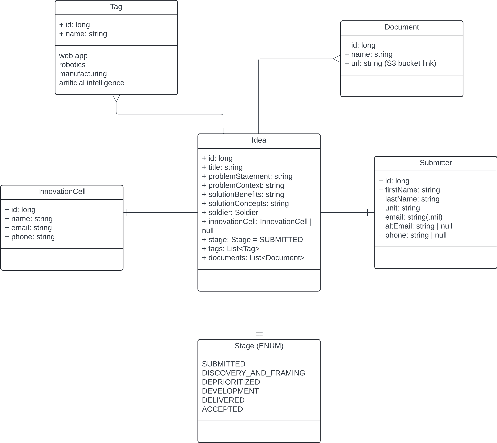

# Getting Started

1. Add `pre-commit` hook to ensure all code is linted before pushing
    ```shell script
      mkdir .git/hooks
      touch .git/hooks/pre-commit
      cp commit-hooks/pre-commit .git/hooks/pre-commit
      chmod +x .git/hooks/pre-commit
    ```
## Java and Node Versions Needed
You will need Java 17 and node version 20

## Running the App Locally

### Start local services

Run `docker-compose up -d` to start Postgres container

### Configure Gemini AI

Dragon Spark uses Gemini through the Spring Boot backend. Create or copy a free-tier API key in Google AI Studio, then start the backend with the key set as an environment variable.

```shell
export GEMINI_API_KEY="your-google-ai-studio-api-key"
export GEMINI_MODEL="gemini-3.5-flash"
```

You can also put those same values in a local `.env` file at the project root:

```shell
GEMINI_API_KEY=your-google-ai-studio-api-key
GEMINI_MODEL=gemini-3.5-flash
```

Do not paste the key into source code or commit it to git.

### Start backend server

`./gradlew bootRun`

The app will be running locally at [https://localhost:8080](https://localhost:8080)

### Start frontend development server

**Note**: Enables hot module reload (HMR) on [https://localhost:3000](https://localhost:3000)

```shell
cd frontend
yarn start
```

## Proposed UML Diagram


